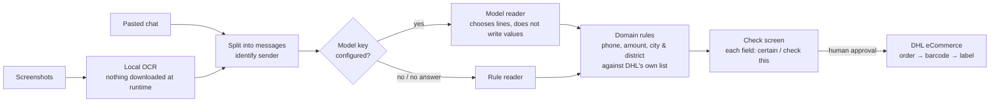

# Fortuna Moda — Chat-to-Shipment Order Panel

**Turns WhatsApp and Instagram DM orders into checked, ready-to-ship DHL eCommerce consignments**

Black Wool Project · **Project Lead & Developer** · [Türkçe](README.tr.md)

> **About this repository.** Built at Black Wool for **Fortuna Moda**, a clothing brand that takes its
> orders in WhatsApp and Instagram chats. Source code is private; this is a case study. Screenshots
> are from the live panel on 28 Oct 2026; customer names are covered.

---

## At a glance

| | |
|---|---|
| **Client** | Fortuna Moda — clothing brand selling through WhatsApp and Instagram DMs, cash on delivery |
| **Flow** | Paste the chat or drop a screenshot → fields are read → the business checks and approves → DHL consignment and label |
| **Reading accuracy** | On a 24-conversation evaluation set: name, address and amount 24/24 with the model reader, **0 confidently-wrong values** for every reader |
| **Status** | Panel live on its own server since Oct 2026 (v1.12.1). DHL eCommerce integration built from the official API specification; the business's carrier account is being connected |
| **Codebase** | 10 models · ~6,000 lines of TypeScript · 36 test files / 236 test cases · 215 commits |

Measured from the repository and the live panel on 28 Oct 2026. The evaluation set is made of invented conversations, not real customers.

---

## The problem

A small brand sells through chat: the customer writes their name, phone, city, district and address
across several messages, often in one long line, with the name sometimes buried in a sentence; the
business answers with the price. Every order was then retyped by hand into the courier's system — slow, and
one wrong district means a parcel that comes back.

The goal was not "let an AI fill the form". It was: **read what can be read, never invent what
cannot, and make every doubtful field impossible to miss** before a shipment is created.

## What I built

| Area | What it does |
|---|---|
| **New order from text** | Paste messages copied from WhatsApp (iPhone and Android formats, multi-line messages); the text is split into messages and the sender of each is identified |
| **New order from screenshots** | Drop one or more chat screenshots; text is extracted by a local OCR model and goes through the same reading pipeline |
| **Check & approve** | Every field is shown as *certain* or *check this*; the business corrects and approves — nothing is shipped without a human approval |
| **Shipment** | DHL eCommerce consignment and label in two steps (order → barcode), label download, status timeline |
| **Orders & summary** | Status ring (awaiting approval, ready, in transit, error), 14-day sparklines, search by name, phone, order no or district; revenue as cash-on-delivery total |
| **Products** | Product and variant list imported from the brand's own website on demand, politely — one request at a time, with pauses |

---

## Screens

<b>New order.</b> Two ways in: screenshots or pasted chat text. Both run through the same reading rules, then the check screen.

---

## Reading pipeline

**AI reads, code decides.** The model is used as a classifier: it picks which line holds the name and
whether each line belongs to the delivery address. The values themselves are cut out of the original
text by rules, and every value then passes the domain rules. A city or district is accepted only if
it matches **exactly one** entry in DHL's own city/district list (with known aliases such as
*Afyonkarahisar → AFYON*); zero or several candidates means *check this*, never a guess.

---

## Engineering decisions

### 1. The metric that matters is "confidently wrong"

A reader that leaves a field empty and flagged costs the business ten seconds. A reader that fills a
wrong value **without a flag** costs a lost parcel. So every reader is measured per field on the same
evaluation set, and the headline number is *confidently wrong* — target 0.

| Reader (24 conversations) | Name | Phone | Address | Amount | Confidently wrong |
|---|---|---|---|---|---|
| OCR + rules | 19/24 | 24/24 | 22/24 | 20/24 | **0** |
| Text → model reader | **24/24** | 24/24 | 24/24 | 24/24 | **0** |
| Screenshot → OCR → model reader | **24/24** | 24/24 | 24/24 | 20/24 | **0** |

The measurement itself is tested: a fake model that knows every answer scores 24/24, and a fake model
that confidently invents values is caught by the *confidently wrong* counter.

### 2. Bugs found end-to-end become test cases

Two cases came from testing the live flow with invented chat screenshots: a name label in the middle
of a sentence ("OK. Name: …") was missed, and a sentence like "OK, I'll take it. Mehmet …" was read
as part of the name **and marked certain**. Both became fixtures in the evaluation set, and name
reading moved into one shared module used by every reader.

### 3. Never trust what the browser says about a file

Uploaded screenshots are typed by their **first bytes**, not by the browser's declared type, before
anything is stored. After approve or cancel, the "return to" address from the form is accepted only if
it points to the panel's own queue page — no open redirect.

### 4. A login limit that does not leak the password

Failed logins are counted in the database (the counter survives a restart). Once the limit is reached,
even the correct password is refused for the rest of the window, so the limit itself cannot be used to
confirm a guessed password. Passwords are hashed with Node's built-in scrypt.

### 5. Three DHL modes, one interface

The DHL client has three interchangeable implementations behind one interface: `fake` (never calls
DHL), `sandbox` and `live`. Keys, passwords and tokens are never written into error messages or logs.
The rest of the system cannot tell which one it is talking to — which is how the panel could go live
and be tested end-to-end before the courier account was connected.

---

## Tech stack

| Layer | Technology |
|---|---|
| App | Next.js 16, React 19, TypeScript (strict), Prisma ORM 7, PostgreSQL, Zod 4 |
| Reading | Rule reader, model reader (classifier over HTTP, no SDK), tesseract.js OCR with a local model file |
| Shipping | DHL eCommerce (MNG ApiZone) REST client: token → createOrder → createbarcode |
| Quality | Vitest — 36 test files, 236 cases, run with `tsc --noEmit` on every merge before an image is built |
| Delivery | Docker, GitHub Actions → GHCR, own containers on a Linux server, Cloudflare Tunnel |

---

## My role

I led the project for Black Wool with the brand owner as first user: the order flow and its
safety rules, the reading pipeline and its evaluation set, the DHL integration from the official
API specification, the panel, and deployment.

## What is not in this repository

Source code, API keys, customer data, the panel's address. The evaluation conversations are invented.
