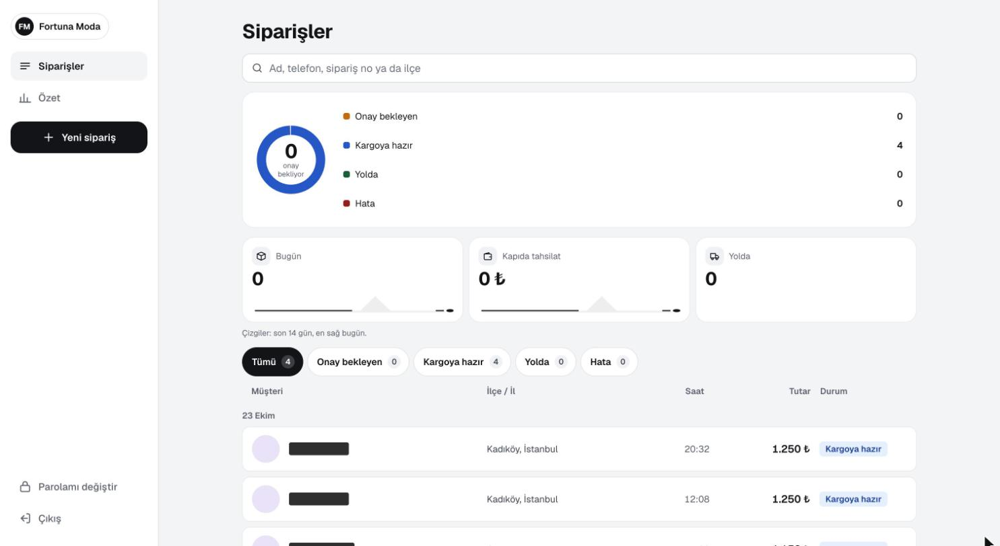
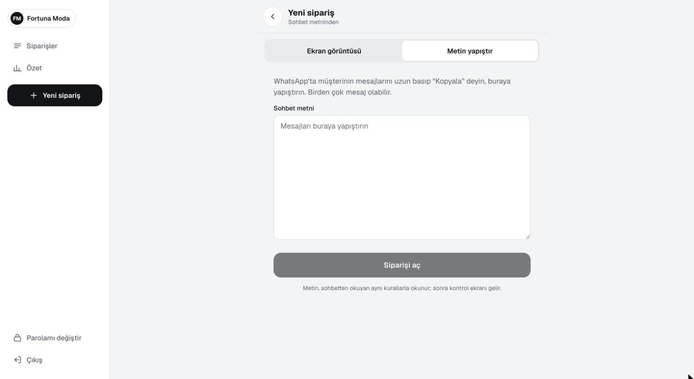
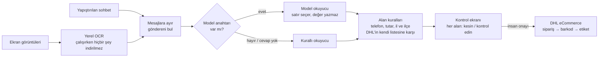

# Fortuna Moda — Sohbetten Kargoya Sipariş Paneli

**WhatsApp ve Instagram DM siparişlerini kontrol edilmiş, gönderime hazır DHL eCommerce kayıtlarına çevirir**

Black Wool Project · **Project Lead & Developer** · [English](README.md)

> **Bu depo hakkında.** Black Wool'da, siparişlerini WhatsApp ve Instagram sohbetlerinden alan giyim
> markası **Fortuna Moda** için geliştirildi. Kaynak kodu gizli; bu bir vaka çalışmasıdır. Ekran
> görüntüleri 28 Ekim 2026'da canlı panelden çekildi; müşteri adları kapatıldı.

---

## Özet

| | |
|---|---|
| **Müşteri** | Fortuna Moda — WhatsApp ve Instagram DM'den satış yapan, kapıda ödemeli giyim markası |
| **Akış** | Sohbeti yapıştır ya da ekran görüntüsü bırak → alanlar okunur → işletme kontrol edip onaylar → DHL kaydı ve etiket |
| **Okuma doğruluğu** | 24 sohbetlik ölçüm setinde model okuyucuyla ad, adres ve tutar 24/24; bütün okuyucularda **0 "yanlış ama kesin"** |
| **Durum** | Panel Ekim 2026'dan beri kendi sunucusunda canlı (v1.12.1). DHL eCommerce entegrasyonu resmî API tanımından yazıldı; işletmenin kargo hesabı bağlanıyor |
| **Kod tabanı** | 10 model · ~6.000 satır TypeScript · 36 sınav dosyası / 236 sınav durumu · 215 commit |

28 Ekim 2026'da depodan ve canlı panelden ölçüldü. Ölçüm seti uydurma sohbetlerden oluşuyor, gerçek müşterilerden değil.

---

## Sorun

Küçük bir marka sohbetten satış yapıyor: müşteri adını, telefonunu, ilini, ilçesini ve adresini
birkaç mesaja dağıtarak, çoğu zaman tek uzun satırda, bazen adı bir cümlenin içine gömerek yazıyor;
işletme fiyatla cevap veriyor. Sonra her sipariş elle kargo sistemine yeniden yazılıyordu — yavaş,
ve tek bir yanlış ilçe geri dönen bir paket demek.

Hedef "yapay zekâ formu doldursun" değildi. Hedef şuydu: **okunabileni oku, okunamayanı asla
uydurma ve gönderi açılmadan önce şüpheli her alanı gözden kaçırılamaz yap.**

## Ne yaptım

| Alan | Ne yapar |
|---|---|
| **Metinden yeni sipariş** | WhatsApp'tan kopyalanan mesajları yapıştır (iPhone ve Android biçimleri, çok satırlı mesajlar); metin mesajlara ayrılır, her mesajın göndereni bulunur |
| **Ekran görüntüsünden yeni sipariş** | Bir ya da birkaç sohbet görüntüsü bırak; metin yerel bir OCR modeliyle çıkarılır ve aynı okuma hattından geçer |
| **Kontrol ve onay** | Her alan *kesin* ya da *kontrol edin* diye gösterilir; işletme düzeltir ve onaylar — insan onayı olmadan hiçbir şey kargoya gitmez |
| **Gönderi** | İki adımda DHL eCommerce kaydı ve etiket (sipariş → barkod), etiket indirme, durum çizelgesi |
| **Siparişler ve özet** | Durum halkası (onay bekleyen, kargoya hazır, yolda, hata), 14 günlük küçük grafikler; ad, telefon, sipariş no ya da ilçeyle arama; ciro kapıda tahsilat toplamı |
| **Ürünler** | Ürün ve beden/renk listesi istendiğinde markanın kendi sitesinden, siteyi yormadan — sırayla ve aralarında bekleyerek — aktarılır |

---

## Ekranlar

<b>Yeni sipariş.</b> İki giriş yolu: ekran görüntüsü ya da yapıştırılan sohbet metni. İkisi de aynı okuma kurallarından, sonra kontrol ekranından geçiyor.

---

## Okuma hattı

**Yapay zekâ okur, kod karar verir.** Model bir sınıflandırıcı olarak kullanılıyor: adın hangi
satırda olduğunu ve her satırın teslimat adresine ait olup olmadığını seçiyor. Değerlerin kendisi
özgün metinden kurallarla kesiliyor ve her değer sonra alan kurallarından geçiyor. Bir il ya da ilçe
ancak DHL'in kendi il/ilçe listesinde **tam olarak bir** kayda uyuyorsa kabul ediliyor (bilinen başka
yazılışlarıyla, ör. *Afyonkarahisar → AFYON*); sıfır ya da birden çok aday *kontrol edin* demek,
asla tahmin değil.

---

## Mühendislik kararları

### 1. Önemli olan ölçü "yanlış ama kesin"

Bir alanı boş ve işaretli bırakan okuyucu işletmeye on saniyeye mal olur. Yanlış bir değeri
**işaretsiz** dolduran okuyucu ise kaybolan bir pakete. Bu yüzden her okuyucu aynı ölçüm setinde alan
alan ölçülüyor ve asıl sayı *yanlış ama kesin* — hedef 0.

| Okuyucu (24 sohbet) | Ad | Telefon | Adres | Tutar | Yanlış ama kesin |
|---|---|---|---|---|---|
| OCR + kural | 19/24 | 24/24 | 22/24 | 20/24 | **0** |
| Metin → model okuyucu | **24/24** | 24/24 | 24/24 | 24/24 | **0** |
| Görüntü → OCR → model okuyucu | **24/24** | 24/24 | 24/24 | 20/24 | **0** |

Ölçümün kendisi de sınanıyor: her cevabı bilen sahte bir model 24/24 alıyor, kendinden emin uyduran
sahte bir model ise *yanlış ama kesin* sayacına düşüyor.

### 2. Uçtan uca bulunan hata sınav durumuna dönüşüyor

İki durum, canlı akışın uydurma sohbet görüntüleriyle sınanmasından çıktı: cümlenin ortasındaki bir ad
etiketi ("Olur. Ad soyad: …") okunmadı, "Tamam alıyorum. Mehmet …" gibi bir cümle adın parçası
sanıldı **ve kesin diye işaretlendi**. İkisi de ölçüm setine eklendi ve ad okuma, bütün okuyucuların
kullandığı tek bir ortak modüle taşındı.

### 3. Tarayıcının dosya hakkında söylediğine güvenme

Yüklenen ekran görüntülerinin türü, saklanmadan önce tarayıcının bildirdiği türden değil, dosyanın
**ilk baytlarından** anlaşılıyor. Onay ya da iptalden sonra formdan gelen "dönülecek adres" yalnız
panelin kendi sıra sayfasını gösteriyorsa kabul ediliyor — açık yönlendirme yok.

### 4. Parolayı sızdırmayan giriş sınırı

Hatalı girişler veritabanında sayılıyor (uygulama yeniden başlasa da sayaç sürüyor). Sınır dolunca
pencerenin sonuna kadar doğru parola da reddediliyor; böylece sınırın kendisi, tahmin edilen bir
parolayı doğrulamak için kullanılamıyor. Parolalar Node'un yerleşik scrypt'iyle özetleniyor.

### 5. Üç DHL kipi, tek arayüz

DHL istemcisinin tek bir arayüz arkasında birbirinin yerine geçebilen üç uygulaması var: `fake`
(DHL'e hiç gitmez), `sandbox` ve `live`. Anahtar, parola ve belirteçler hata mesajına ya da kayda hiç
yazılmıyor. Sistemin geri kalanı hangisiyle konuştuğunu bilmiyor — panel bu sayede kargo hesabı
bağlanmadan canlıya çıkıp uçtan uca sınanabildi.

---

## Teknolojiler

| Katman | Teknoloji |
|---|---|
| Uygulama | Next.js 16, React 19, TypeScript (strict), Prisma ORM 7, PostgreSQL, Zod 4 |
| Okuma | Kurallı okuyucu, model okuyucu (HTTP üzerinden sınıflandırıcı, SDK yok), yerel model dosyalı tesseract.js OCR |
| Kargo | DHL eCommerce (MNG ApiZone) REST istemcisi: belirteç → createOrder → createbarcode |
| Kalite | Vitest — 36 sınav dosyası, 236 durum; her birleşmede imaj derlenmeden önce `tsc --noEmit` ile birlikte çalışır |
| Dağıtım | Docker, GitHub Actions → GHCR, Linux sunucuda kendi konteynerleri, Cloudflare Tunnel |

---

## Rolüm

Projeyi Black Wool adına, marka sahibi ilk kullanıcı olacak şekilde yönettim: sipariş akışı ve
güvenlik kuralları, okuma hattı ve ölçüm seti, resmî API tanımından DHL entegrasyonu, panel ve
dağıtım.

## Bu depoda olmayanlar

Kaynak kod, API anahtarları, müşteri verileri, panelin adresi. Ölçüm sohbetleri uydurmadır.
